# Tarea 5 — Inventario con Docker Compose

## Portada

**Grupo:** 3  
**Componente asignado:** Almacenamiento  
**Integrantes y números de cuenta:**

| Integrante | Número de cuenta |
|---|---|
| Melvin Edgardo Peña Caballero | 201230010100 |
| [Agregar otro integrante si aplica] | [Número de cuenta] |

**Asignatura:** Arquitectura de Computadoras  
**Primera validación:** 13 de noviembre de 2026  
**Actualización de pruebas y evidencias:** 14 de noviembre de 2026

> **Informe actualizado, conservando el historial.** Se mantienen las verificaciones, resultados y capturas de la primera revisión del 13 de noviembre y se añaden las pruebas que el estudiante ejecutó el 14 de noviembre. Se incorporan las 14 capturas compartidas en las sesiones, además de las dos capturas suplementarias generadas para documentar la interfaz y el estado de la API. Las evidencias son para comparación; las salidas también se transcriben como texto. La lista literal de los diez pasos y las preguntas exactas del módulo no están disponibles en el workspace, por lo que la matriz distingue requisitos verificados de pasos pendientes y no afirma ser una transcripción literal de Canvas.

## Resumen actualizado al 14 de noviembre

| Área | Estado actualizado |
|---|---|
| Aplicación y Compose | API healthy y web en `8083:80`; interfaz y endpoints responden. El Compose real se dejó intacto durante las pruebas aisladas. |
| Usuario, Gunicorn y healthcheck | `whoami` devuelve `app`; API healthy; imagen de producción declara 2 workers y healthcheck cada 10 segundos. |
| Límites del servicio API | Inspect confirma 128 MiB, 0.50 CPU y 100 PIDs. |
| Registro/persistencia | En el entorno aislado se agregó un registro; `down` conservó el volumen y `down -v` lo eliminó. Tras recrearlo, la API devolvió los cinco registros semilla; el marcador ya no estaba. El volumen real `g3-inventario-datos` se conservó. |
| Carga y cgroups | `g3-estres` se observó a 147.61% CPU, 140.9 MiB/512 MiB y 5 PIDs; cgroups concordaron con Inspect. Bajar a 0.5 CPU queda para la exposición. |
| Docker Hub | `penia93/g3-discos-api:1.0` es pública y corrió localmente en el puerto 5050. Falta repetir en el equipo de otro integrante. |
| Requisitos pendientes | Registrar 3 componentes (se probó 1), guardar la salida del build, bajar stress a 0.5 CPU y demostrar la imagen en otro equipo. SQL Server no se verificó como servicio funcional. |

El detalle histórico que sigue a continuación se conserva para comparar las primeras verificaciones con esta actualización.

## Resumen de validación inicial (13 de noviembre)

| Requisito | Estado observado |
|---|---|
| Sintaxis e interpolación de `compose.yaml` | Verificado: `docker compose config --quiet` terminó correctamente. |
| API | Verificada: responde HTTP 200 y Compose la reporta `healthy`. |
| Aplicación web | Verificada: responde HTTP 200 en `http://127.0.0.1:8083/`; lista cinco discos mediante la API. |
| Registro y persistencia tras reinicio | Probado solo en un contenedor y volumen temporales aislados: POST 201 y el registro de prueba sobrevivió a recrear el contenedor. No se modificó la base real. |
| Límites y monitoreo | Verificados en la API y en el contenedor temporal: `docker run`, `docker stats`, `inspect`, cgroups y `docker update`. Las ejecuciones las hizo el asistente; no son capturas de la práctica del estudiante. |
| Límites del servicio web | Pendiente: `web` no declara límites de recursos en Compose. |
| Evidencia de `docker run`, `docker stats`, `inspect`, cgroups y `docker update` | Se probaron comandos sobre un contenedor temporal aislado. Faltan las capturas ejecutadas por el estudiante con fecha/hora del equipo. |
| Docker Hub y ejecución en otro equipo | Pendiente de verificar: solo se identificaron las imágenes locales `g3-discos-api:1.0` y `g3-discos-web:1.0`; no hay URL de Docker Hub ni evidencia de ejecución externa. |
| Punto extra de SQL Server | No aprobado en el estado observado: el contenedor se reinicia (código 255) porque la contraseña configurada no satisface la política de complejidad de SQL Server. No se incluye ni se reproduce la contraseña. |
| Estructura y evidencias del informe | Parcial: se generaron capturas complementarias; faltan las capturas terminales de la práctica con reloj visible. |

## Diagrama de la aplicación

```text
Navegador
   │ HTTP :8083 (host)
   ▼
web — nginx :80
   │ proxy /api/* → api:5000
   ▼
api — Flask + Gunicorn :5000  [healthcheck: /api/estado]
   │
   ▼
volumen Docker g3-inventario-datos montado en /datos
   │
   └── SQLite: /datos/inventario.db

Todos los servicios se conectan a la red bridge red-g3.

Servicio adicional:
sqlserver — SQL Server 2022, nombre DNS interno: sqlserver:1433
             volumen g3-inventario-sql-datos
             estado observado: reiniciándose
```

La API no publica un puerto en el host; la web es el punto de entrada publicado. La red de Compose permite que nginx alcance la API por el nombre del servicio `api`. SQL Server no publica un puerto del host, pero su nombre de servicio permite el acceso interno a través de `red-g3` cuando esté operativo.

## Configuración y explicación

### `compose.yaml`

El proyecto se llama `g3-inventario`. Compose construye y etiqueta la API y la web, publica el puerto 8083 del host hacia el puerto 80 de nginx, espera a que la API esté healthy antes de iniciar la web y define dos volúmenes persistentes y una red compartida. Los límites de CPU/memoria/PID están configurados para la API; SQL Server tiene un límite de memoria. El servicio web no tiene límites configurados.

```yaml
name: g3-inventario

services:
  api:
    image: g3-discos-api:1.0
    build:
      context: ./api
      dockerfile: Dockerfile.prod
    environment:
      APP_NOMBRE: g3-discos-api
      DB_PATH: /datos/inventario.db
    volumes:
      - datos:/datos
    networks:
      - red-g3
    restart: unless-stopped
    deploy:
      resources:
        limits:
          cpus: "0.50"
          memory: 128M
          pids: 100
    healthcheck:
      test:
        - CMD
        - python
        - -c
        - "import urllib.request; urllib.request.urlopen('http://127.0.0.1:5000/api/estado', timeout=2)"
      interval: 10s
      timeout: 3s
      retries: 3
      start_period: 15s

  web:
    image: g3-discos-web:1.0
    build:
      context: ./web
      dockerfile: Dockerfile
    ports:
      - "8083:80"
    depends_on:
      api:
        condition: service_healthy
    networks:
      - red-g3
    restart: unless-stopped

  sqlserver:
    image: mcr.microsoft.com/mssql/server:2022-latest
    platform: linux/amd64
    environment:
      ACCEPT_EULA: "Y"
      MSSQL_PID: Developer
      MSSQL_SA_PASSWORD: ${MSSQL_SA_PASSWORD:?Definir contraseña en .env}
      MSSQL_MEMORY_LIMIT_MB: "1536"
    volumes:
      - sql-datos:/var/opt/mssql
    networks:
      - red-g3
    deploy:
      resources:
        limits:
          memory: 2G
    restart: unless-stopped

volumes:
  datos:
    name: g3-inventario-datos
  sql-datos:
    name: g3-inventario-sql-datos

networks:
  red-g3:
    name: red-g3
    driver: bridge
```

### `api/Dockerfile.prod`

La imagen parte de Python 3.12 slim, instala dependencias, crea un usuario de sistema sin privilegios, reserva `/datos` para almacenamiento persistente, declara un `HEALTHCHECK` HTTP y arranca Gunicorn con dos trabajadores. El proceso de la aplicación ejecuta como `app`, no como root.

```dockerfile
FROM python:3.12-slim

LABEL grupo="3"
LABEL componente="Almacenamiento"
LABEL aplicacion="g3-discos-api"
LABEL version="1.0"

ENV PYTHONDONTWRITEBYTECODE=1 \
    PYTHONUNBUFFERED=1 \
    APP_NOMBRE=g3-discos-api \
    DB_PATH=/datos/inventario.db

WORKDIR /app

# Instalar dependencias
COPY requirements.txt .

RUN pip install --no-cache-dir -r requirements.txt

# Copiar el codigo de la aplicacion
COPY . .

# Crear usuario sin privilegios y directorio de datos
RUN groupadd --system app \
    && useradd --system --gid app --home-dir /app app \
    && mkdir -p /datos \
    && chown -R app:app /app /datos

# Directorio persistente
VOLUME /datos

# Cambiar a usuario sin privilegios
USER app

EXPOSE 5000

# Verificar que la API responda
HEALTHCHECK --interval=10s \
    --timeout=3s \
    --start-period=15s \
    --retries=3 \
    CMD python -c "import urllib.request; urllib.request.urlopen('http://127.0.0.1:5000/api/estado', timeout=2)" || exit 1

# Servidor de produccion con 2 trabajadores
CMD ["gunicorn", "--preload", "--workers", "2", "--bind", "0.0.0.0:5000", "app:app"]
```

### `web/nginx.conf`

nginx sirve los archivos estáticos desde `/usr/share/nginx/html`. Las solicitudes bajo `/api/` se envían al servicio `api` en el puerto interno 5000. No se fija la dirección IP del contenedor, por lo que la resolución DNS de la red de Compose puede seguir los cambios de dirección.

```nginx
server {
    listen 80;
    server_name _;

    root /usr/share/nginx/html;
    index index.html;

    location / {
        try_files $uri $uri/ =404;
    }

    location /api/ {
        proxy_pass http://api:5000;
        proxy_http_version 1.1;

        proxy_set_header Host $host;
        proxy_set_header X-Real-IP $remote_addr;
        proxy_set_header X-Forwarded-For
                         $proxy_add_x_forwarded_for;
        proxy_set_header X-Forwarded-Proto $scheme;

        proxy_connect_timeout 5s;
        proxy_read_timeout 30s;
    }
}
```

## Práctica: primera lista de diez verificaciones (13 de noviembre)

> La lista siguiente organiza los criterios y comandos indicados en el enunciado compartido. No se pudo cotejar con los diez pasos literales del módulo porque Canvas redirigió a la pantalla de inicio de sesión. Cada captura requerida debe añadirse después de repetir el paso: terminal o navegador completo, fecha y hora del equipo visibles, y el comando como texto.

| Paso | Comando o acción | Resultado de esta validación | Captura |
|---|---|---|---|
| 1. Validar Compose | `docker compose config --quiet` | Verificado; terminó sin error. | Pendiente |
| 2. Levantar API y web | `docker compose up -d --build` | No se reinició durante esta validación. API y web ya estaban ejecutándose; SQL Server reinicia. | Pendiente |
| 3. Revisar estado y health | `docker compose ps -a` | API `healthy`; web `Up`; SQL Server `Restarting (255)`. Captura del endpoint con fecha/hora UTC incluida en este informe. | Parcial |
| 4. Probar interfaz y API | `curl -i http://localhost:8083/` y `curl -i http://localhost:8083/api/discos` | HTTP 200; la lista devolvió cinco discos. Se capturó la interfaz web; no se envió un POST para no cambiar datos. La captura web no incluye el reloj del sistema. | Parcial |
| 5. Revisar persistencia | Prueba aislada con volumen temporal, POST de un disco de prueba, recreación del contenedor y GET | Verificado: el registro sobrevivió en el volumen temporal. No se tocó `g3-inventario-datos`. | Sin captura oficial |
| 6. Ejecutar límites con `docker run` | `docker run ... --memory=128m --cpus=0.50 --pids-limit=100 ...` | Ejecutado por el asistente en `g3-tarea5-prueba-persistencia`; inició healthy con 128 MiB, 0.5 CPU y 100 PIDs. | Sin captura oficial |
| 7. Inspeccionar consumo | `docker stats --no-stream g3-inventario-api-1 g3-inventario-web-1 g3-tarea5-prueba-persistencia` | Ejecutado: API 47.45 MiB/128 MiB, web 17.27 MiB y contenedor temporal 40.79 MiB/128 MiB. | Sin captura oficial |
| 8. Inspeccionar configuración/cgroups | `docker inspect` y lectura de `/sys/fs/cgroup/{memory.max,cpu.max,pids.max}` | API: 128 MiB, 0.5 CPU, 100 PIDs. Contenedor temporal: mismos límites inicialmente; cgroups coincidió. La inspección conjunta falló al pedir `.State.Health` para web, que no tiene healthcheck. | Sin captura oficial |
| 9. Actualizar límites | `docker update --memory=160m --cpus=0.60 --pids-limit=120 g3-tarea5-prueba-persistencia` | Ejecutado solo en el contenedor temporal: inspect/cgroups confirmó 160 MiB, 0.6 CPU y 120 PIDs. | Sin captura oficial |
| 10. SQL Server y publicación | Verificar `sqlserver:1433`; revisar etiquetas locales y enlace Docker Hub | SQL Server sigue `Restarting (255)`. La comprobación de red fue interrumpida y no confirmó el acceso. Solo aparecen etiquetas locales; no se proporcionó enlace de Docker Hub. | Pendiente |

Ejemplo de comandos de observación para capturar en la práctica (no ejecutados como evidencia):

```sh
docker compose ps -a
docker stats --no-stream
docker inspect g3-inventario-api-1
docker exec g3-inventario-api-1 sh -c 'cat /sys/fs/cgroup/memory.max; cat /sys/fs/cgroup/cpu.max; cat /sys/fs/cgroup/pids.max'
```

### Capturas suplementarias de navegador

Estas capturas corresponden al estado observado en vivo. La página de estado incluye la fecha/hora UTC reportada por la API; la página de inventario no muestra el reloj del sistema, por lo que su captura es complementaria y no reemplaza la evidencia reglamentaria.

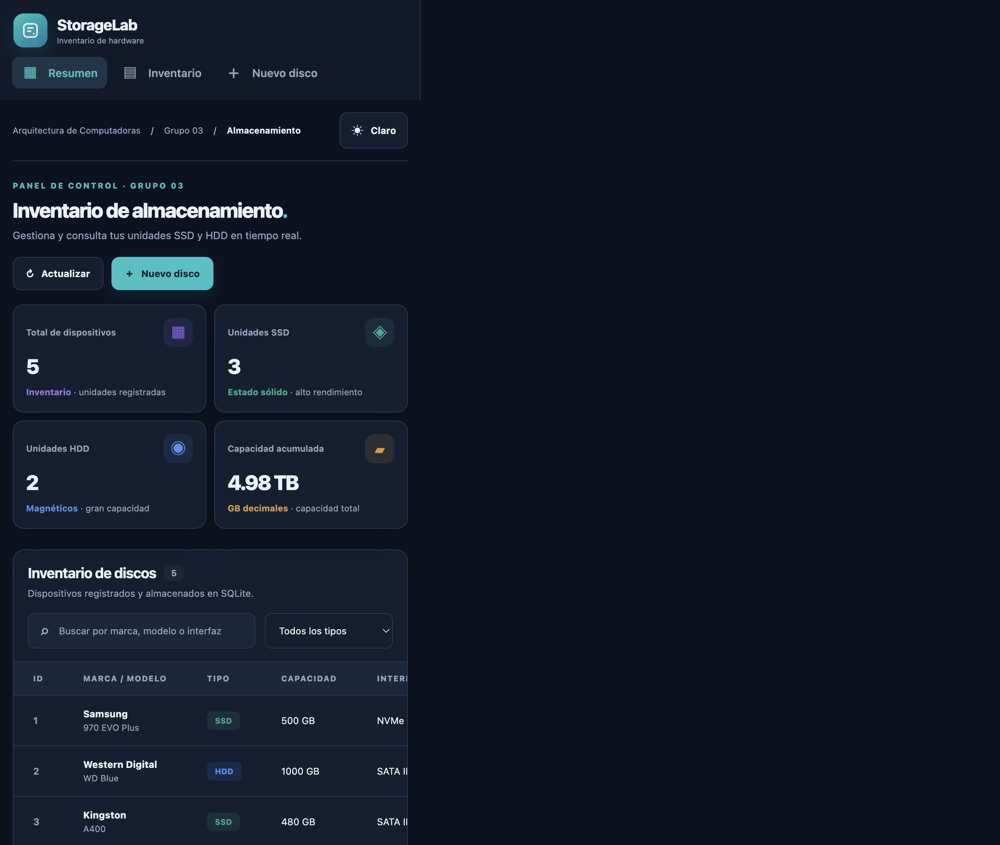

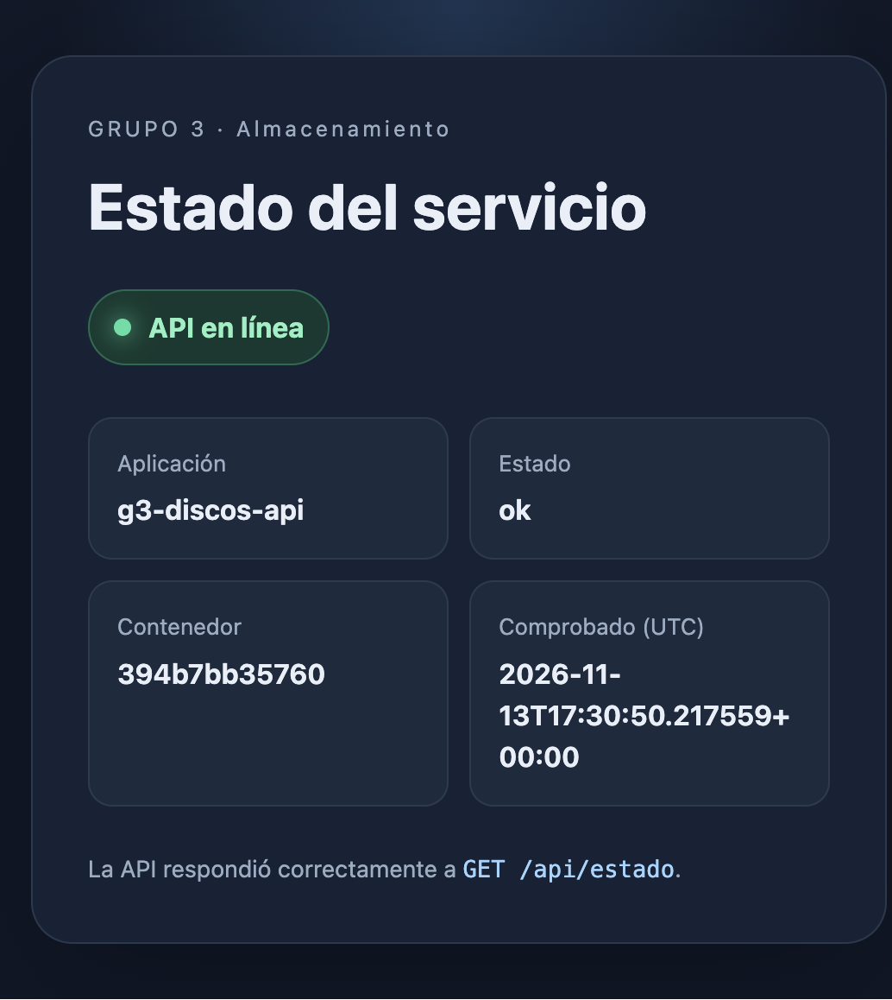

## Preguntas de análisis

El texto compartido no trae preguntas con redacción literal. Las respuestas siguientes se redactaron a partir de los criterios de análisis/rúbrica proporcionados; cotejarlas con el cuestionario de Canvas antes de entregar.

**¿Para qué se usa `healthcheck` y cómo se relaciona con `depends_on`?**  
El `healthcheck` consulta `/api/estado` para comprobar que la API responde, no solo que el proceso existe. `depends_on` con `condition: service_healthy` hace que nginx espere a esa condición antes de iniciar. Durante esta validación Compose reportó la API como `healthy`.

**¿Cómo persisten los datos de la API?**  
La base SQLite se guarda en `/datos/inventario.db`, dentro del volumen nombrado `g3-inventario-datos`. El volumen se administra fuera del ciclo de vida del contenedor, por lo que está diseñado para conservar la base al reemplazar la API. En esta revisión se confirmó la configuración y lectura de registros, pero no se hizo una prueba destructiva de recreación.

**¿Cómo se comunica nginx con Flask y qué puerto usa el usuario?**  
El navegador entra por el puerto 8083 del host, mapeado al puerto 80 de nginx. nginx reenvía `/api/` al nombre de servicio `api` en el puerto 5000 dentro de la red `red-g3`; ese puerto interno no se publica directamente en el host.

**¿Cómo se limitan y monitorean los recursos?**  
Compose establece para la API un máximo de 0.5 CPU, 128 MiB y 100 procesos. `docker stats` permite observar consumo; `docker inspect` y cgroups permiten verificar límites efectivos. `docker run` sirve para iniciar un contenedor con límites desde su creación y `docker update` para modificar los de un contenedor ya iniciado. La rúbrica solicita capturas de esas pruebas; varias siguen pendientes.

**¿Qué aporta el Dockerfile de producción?**  
Ejecuta la API como el usuario sin privilegios `app`, usa Gunicorn con dos trabajadores y define una comprobación de salud. Esas decisiones separan el servidor de producción del servidor de desarrollo de Flask y permiten que Docker detecte fallos de respuesta.

**¿Qué falta para obtener el punto extra de SQL Server?**  
El servicio debe arrancar estable y ser accesible desde la red de Compose por `sqlserver:1433`. En esta revisión no lo cumple: SQL Server rechazó la contraseña configurada por no cumplir su política de complejidad y el contenedor se reinicia.

## Problemas encontrados y resolución pendiente

1. **SQL Server reinicia con código 255.** Los logs indican que la contraseña de administrador no satisface la política: al menos ocho caracteres y caracteres de al menos tres de estas cuatro categorías: mayúsculas, minúsculas, dígitos y símbolos. No se leyó ni se incluyó el valor actual. Actualizar `MSSQL_SA_PASSWORD` en `.env` con una contraseña que cumpla la política, conservarla fuera del informe y reiniciar el servicio; después confirmar que queda estable y que otro contenedor de `red-g3` lo alcanza como `sqlserver:1433`. No se hizo este cambio durante una validación solicitada como revisión.
2. **El servicio web no declara límites.** Añadir los límites requeridos por el enunciado para `web`, si el docente exige que apliquen a todos los servicios, y probarlos con `inspect`/cgroups. No se modificó Compose en esta revisión.
3. **Evidencias incompletas.** Se anexan capturas suplementarias del navegador. La del endpoint muestra fecha/hora UTC que informa la API; la imagen de inventario no muestra el reloj del sistema y no sustituye la captura requerida. Adjuntar las capturas reales de los diez pasos con terminal/navegador completo, fecha y hora del equipo, y los comandos como texto. No reutilizar capturas de otros grupos.
4. **No hay identificación del equipo ni URL pública.** Completar los nombres y números de cuenta y agregar el enlace de la imagen de Docker Hub con evidencia de ejecución en otro equipo.

## Conclusiones de la primera revisión (13 de noviembre)

La aplicación principal funciona en el entorno inspeccionado: Compose valida, nginx responde en el puerto 8083, la API responde y se reporta healthy, y el inventario se consulta. La API tiene límites efectivos de recursos y almacenamiento persistente configurado mediante un volumen nombrado. Se adjuntan dos capturas suplementarias hechas desde el navegador. Sin embargo, la entrega **no está lista para calificarse como completa**: SQL Server se reinicia por la contraseña, faltan las evidencias reglamentarias de varios pasos y los comandos de límites/actualización, la imagen de inventario no tiene reloj del sistema visible, no se aportó URL de Docker Hub y las respuestas deben cotejarse con las preguntas literales de Canvas.

## Bitácora de acciones de validación (13 de noviembre de 2026)

> **Importante:** el usuario pidió que las pruebas se hicieran paso a paso, con él ejecutando cada comando. El asistente se adelantó y ejecutó varias de las comprobaciones descritas abajo. Esta bitácora registra lo que ocurrió; no presenta esas ejecuciones como práctica realizada por el estudiante ni como capturas válidas para Canvas. A partir de la interrupción del usuario no se hicieron más pruebas.

### Acciones y resultados

1. `docker compose config --quiet`: terminó correctamente (`COMPOSE_CONFIG_OK`).
2. `docker compose ps -a`: API `healthy`, web `Up` y SQL Server `Restarting (255)`.
3. `curl` de solo lectura: web HTTP 200, `/api/estado` HTTP 200 e inventario HTTP 200 con cinco discos.
4. `docker compose up -d api web`: Compose informó ambos servicios `Running` y la API `Healthy`; no se solicitó ni se hizo build. La base de datos real no se modificó.
5. Se comprobó que los nombres de prueba estaban libres. Se creó el volumen temporal `g3-tarea5-prueba-datos` y se inició `g3-tarea5-prueba-persistencia` desde `g3-discos-api:1.0`, sin puertos publicados, con 128 MiB, 0.5 CPU y límite de 100 PIDs. El healthcheck quedó `healthy`.
6. Se envió un POST únicamente a esa API temporal. Respondió HTTP 201 e insertó `G3-PRUEBA-TRANSITORIA` (ID 6) en el volumen temporal.
7. Se detuvo y eliminó ese contenedor, se creó de nuevo con el mismo volumen y se consultó la API: total 6; el registro marcador seguía presente (una coincidencia). Esto valida persistencia del volumen de prueba, no la base real.
8. `docker stats --no-stream` sobre API, web y contenedor temporal: API 47.45 MiB/128 MiB; web 17.27 MiB; temporal 40.79 MiB/128 MiB.
9. `inspect` y cgroups en la API y el contenedor temporal confirmaron inicialmente 128 MiB, 0.5 CPU y 100 PIDs (`memory.max=134217728`, `cpu.max=50000 100000`, `pids.max=100`).
10. `docker update --memory=160m --cpus=0.60 --pids-limit=120` se aplicó solo al contenedor temporal. `inspect` y cgroups confirmaron 167772160 bytes, `60000 100000` y 120 PIDs.
11. Una inspección conjunta de API/web/prueba produjo error de plantilla al solicitar `.State.Health.Status` para web; web no declara healthcheck. Los datos impresos antes del error para API y el contenedor temporal sí mostraron sus límites.
12. La inspección de la red `red-g3` mostró API y web conectados; SQL Server no aparecía como contenedor conectado en ese instante. Solo se encontraron localmente `g3-discos-api:1.0` y `g3-discos-web:1.0`; esto no acredita publicación en Docker Hub.
13. Se inició una prueba adicional con `docker network connect red-g3 g3-tarea5-prueba-persistencia` seguida de una comprobación DNS/TCP a `sqlserver:1433`, pero la ejecución fue interrumpida. **No se sabe si alcanzó a conectar el contenedor temporal a la red; el resultado DNS/TCP no se obtuvo.**

### Recursos temporales y limpieza pendiente (estado al 13 de noviembre)

Al detener la secuencia quedaron creados el contenedor temporal `g3-tarea5-prueba-persistencia` y el volumen `g3-tarea5-prueba-datos`; el contenedor podría seguir adjunto a `red-g3` si la última operación alcanzó a completarse. También se escribió la respuesta de health a `/tmp/g3-health.json`. No se limpió nada después de la interrupción.

El comando de limpieza exacto que se propuso al usuario (aún no ejecutado) es:

```sh
docker rm -f g3-tarea5-prueba-persistencia && docker volume rm g3-tarea5-prueba-datos
```

Ese comando elimina únicamente el contenedor y volumen temporales indicados. No elimina el volumen real `g3-inventario-datos`, no borra el inventario real y no cambia `.env`. El siguiente paso debe esperar a que el usuario ejecute la limpieza indicada y comparta el resultado; después, entregar **un solo comando de prueba por turno** y esperar su salida antes de continuar.

## Actualización de práctica: resultados compartidos el 14 de noviembre

Esta sección agrega pruebas nuevas sin reemplazar la primera lista de verificaciones ni la bitácora del 13 de noviembre. Las pruebas nuevas de persistencia se hicieron solamente en `g3-tarea5-validacion`, con puerto `8084`, red `g3-tarea5-validacion-red` y volumen `g3-tarea5-validacion-datos`.

### Matriz de los diez requisitos cotejados

| N.º | Requisito/prueba | Comando o acción | Resultado comparativo |
|---:|---|---|---|
| 1 | SQLite en `/datos/inventario.db`, `DB_PATH` y `POST /api/discos` | Revisar repositorio/rutas; registrar desde `http://localhost:8084/`; `curl -i http://localhost:8084/api/discos` | Implementado y probado en el stack aislado. Se agregó 1 componente; `down`/`up` conservó el registro y devolvió 6 en total. **Parcial:** la práctica pide 3 registros. |
| 2 | Producción: usuario `app`, directorio/volumen `/datos`, Gunicorn con 2 workers y healthcheck de 10 s | `docker exec ... whoami`; inspección de `.State.Health` y `.Config.Healthcheck` | `whoami` devolvió `app`; estado `healthy`. Dockerfile declara dos workers y prueba `/api/estado` cada 10 segundos. |
| 3 | Web, tabla, actualizar, formulario POST y proxy `/api/` a `api:5000` | Revisar `web/app.js` y `web/nginx.conf`; abrir sitio/registrar componente en `localhost:8084` | Página web y formulario de prueba funcionales. Se documentó la captura de la interfaz y el GET de la API. |
| 4 | Compose: API, web, volumen, red, healthcheck, dependencia healthy y publicación solo del puerto web | `docker compose config --quiet`; `docker compose up -d api web`; `docker compose ps api web` | Configuración válida; API `Up (healthy)` y web `Up` en `8083:80`. |
| 5 | API con `restart: unless-stopped`, 0.50 CPU, 128 MiB y 100 PIDs | `docker inspect --format 'name={{.Name}} memory={{.HostConfig.Memory}} nano_cpus={{.HostConfig.NanoCpus}} pids={{.HostConfig.PidsLimit}}' ...` | API: `134217728` bytes, `500000000` nano-CPU y 100 PIDs. Web no declara límites explícitos. |
| 6 | `docker compose up -d --build`, API healthy y registro de 3 componentes | Compose principal se revisó sin reconstruirlo en esta prueba; registro desde formulario sobre stack aislado | API healthy y un registro de prueba insertado. **Parcial:** no se capturó salida de `up -d --build` ni se ingresaron los 3 componentes. |
| 7 | `id`/usuario, `down` preservando volumen y `down -v` eliminándolo | `docker exec ... whoami`; `docker compose ... down`; luego `docker compose ... down -v`; listar volúmenes y consultar API tras levantar de nuevo | `down` conservó el marcador (total 6). `down -v` eliminó el volumen aislado; `docker volume ls` confirmó su ausencia. Tras `up`, la API devolvió HTTP 200 y `total: 5`; el marcador se perdió. `g3-inventario-datos` permaneció. |
| 8 | Imagen de estrés con `stress-ng`, 1.5 CPU, 512 MiB, 100 PIDs y `docker stats` | `docker inspect`; `docker update --cpus=1.5 g3-estres`; `docker start`; `docker stats --no-stream g3-estres` | 147.61% CPU, 140.9 MiB/512 MiB, 5 PIDs. Imagen `g3/estres:1.0`, proceso con timeout de 300 s. **Parcial:** no se conservó el comando/salida original de `docker build`. |
| 9 | Comparar `inspect` y cgroups; bajar a 0.5 CPU; observar namespaces/procesos | Leer `/sys/fs/cgroup/cpu.max`, `memory.max`, `pids.max`; `ls /proc/self/ns`, `hostname`, `ps -e` | Valores concordantes: `150000 100000`, `536870912`, `100`; hostname `eef4578461b7`; namespaces/procesos visibles. **Pendiente en vivo:** `docker update --cpus=0.5 g3-estres`; queda a 1.5 CPU hasta la exposición. |
| 10 | Publicar, descargar y ejecutar imagen API en otro equipo | Repositorio `penia93/g3-discos-api:1.0`; Docker Desktop Run puerto `5050:5000`; GET `/api/estado` y `/api/discos` | Repositorio público y ejecución local confirmados; estado HTTP 200 e inventario con 5 registros. **Pendiente:** correrla en el equipo de otro integrante. |

> La matriz organiza las pruebas a partir de los criterios compartidos y de las verificaciones ejecutadas; no se presenta como copia literal de la página de Canvas, cuyo listado de pasos no está guardado en el workspace.

### Transcripciones nuevas para comparar

**Stack principal**

```text
docker compose config --quiet
compose valido

g3-inventario-api-1   Up (healthy)   5000/tcp
g3-inventario-web-1   Up             0.0.0.0:8083->80/tcp

GET http://localhost:8083/api/estado  -> HTTP 200, estado "ok"
GET http://localhost:8083/api/discos  -> HTTP 200, total 5
GET http://localhost:8083/            -> HTTP 200, text/html
```

**Persistencia del registro de prueba con `down` sin borrar volumen**

```text
HTTP/1.1 200 OK
"id":6,"marca":"SAMSUNG_2","modelo":"990 PRO_2","tipo":"SSD"
"total":6
```

**Prueba controlada de `down -v` sobre el proyecto aislado**

Se ejecutó `docker compose -p g3-tarea5-validacion -f - down -v` con configuración que declara explícitamente el volumen de prueba. Docker informó:

```text
[+] down 3/3
✔ Container g3-tarea5-validacion-web-1 Removed
✔ Container g3-tarea5-validacion-api-1 Removed
✔ Volume g3-tarea5-validacion-datos Removed
```

`docker volume ls` confirmó que `g3-tarea5-validacion-datos` ya no aparecía y que `g3-inventario-datos` seguía presente. Se volvió a levantar el stack aislado; se creó un volumen vacío. Nginx salió inicialmente porque no resolvió `api` al arrancar; la API estaba healthy. Tras ejecutar `docker start g3-tarea5-validacion-web-1`, el GET volvió a funcionar:

```text
curl -i http://localhost:8084/api/discos
HTTP/1.1 200 OK
"total":5
```

La respuesta incluyó los cinco registros iniciales y ya no incluía `SAMSUNG_2`. Este resultado demuestra la diferencia: `down` conserva el volumen, `down -v` lo elimina. La prueba no tocó `g3-inventario-datos`.

**Carga y cgroups**

```text
docker stats --no-stream g3-estres
CPU: 147.61%
Memoria: 140.9MiB / 512MiB
PIDs: 5

cpu.max=150000 100000
memory.max=536870912
pids.max=100
```

El contenedor ejecutaba `stress-ng --cpu 2 --vm 1 --vm-bytes 128M --timeout 300s`; además se listaron `/proc/self/ns`, `hostname` y `ps -e`.

**Imagen pública**

`penia93/g3-discos-api:1.0` se consultó en Docker Hub y se ejecutó localmente en `5050:5000`. `/api/estado` respondió HTTP 200 y `/api/discos` devolvió 5 registros. La captura confirma ejecución local, no en un segundo equipo.

### Evidencias visuales conservadas

Se mantienen las dos capturas suplementarias generadas para documentar la interfaz y el estado de API. Además, se anexan en el orden de recepción las **14 capturas compartidas por el usuario** entre el 9 y el 14 de noviembre. Las imágenes completas conservan la barra del sistema con fecha/hora cuando estaba visible en la captura original. Las capturas son referencias comparativas; los comandos y resultados también se copian como texto en este informe.

#### Capturas compartidas el 9 y 12 de noviembre

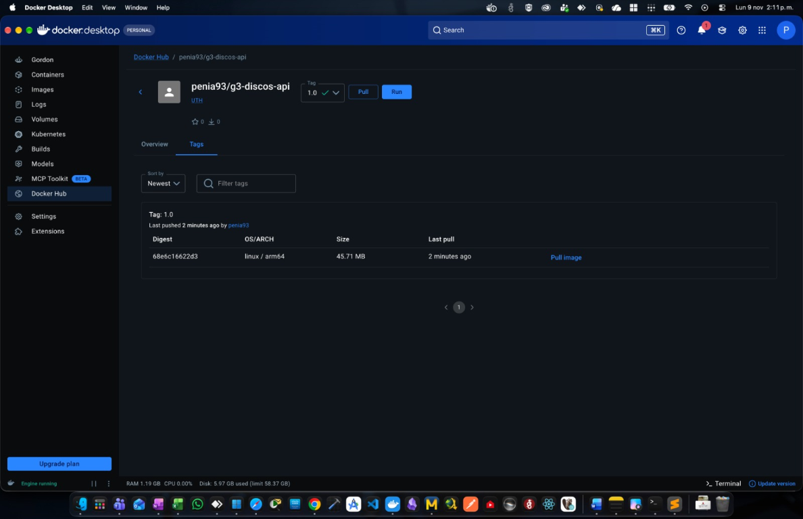

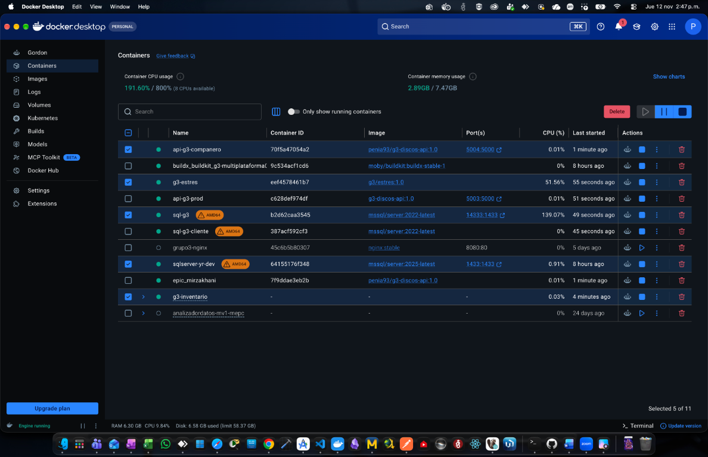

#### Capturas compartidas el 14 de noviembre

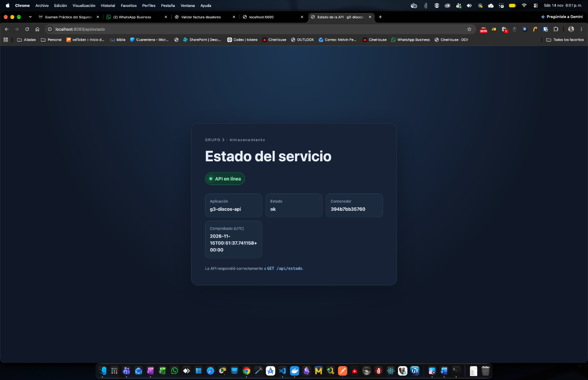

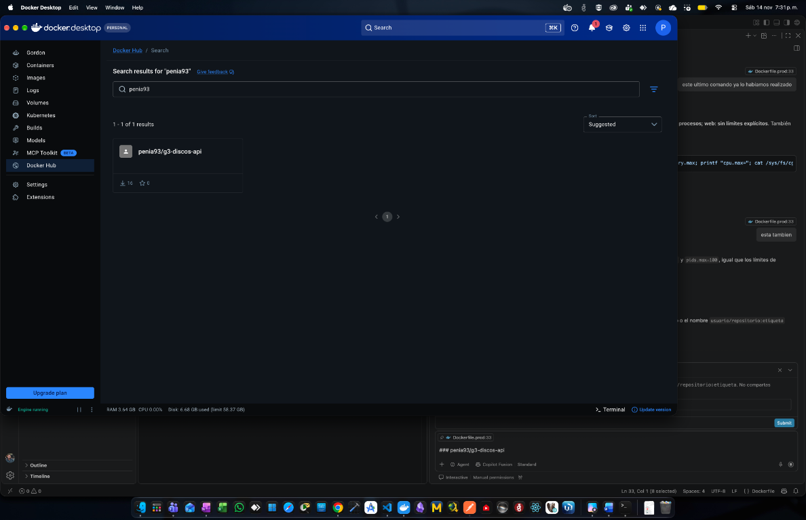

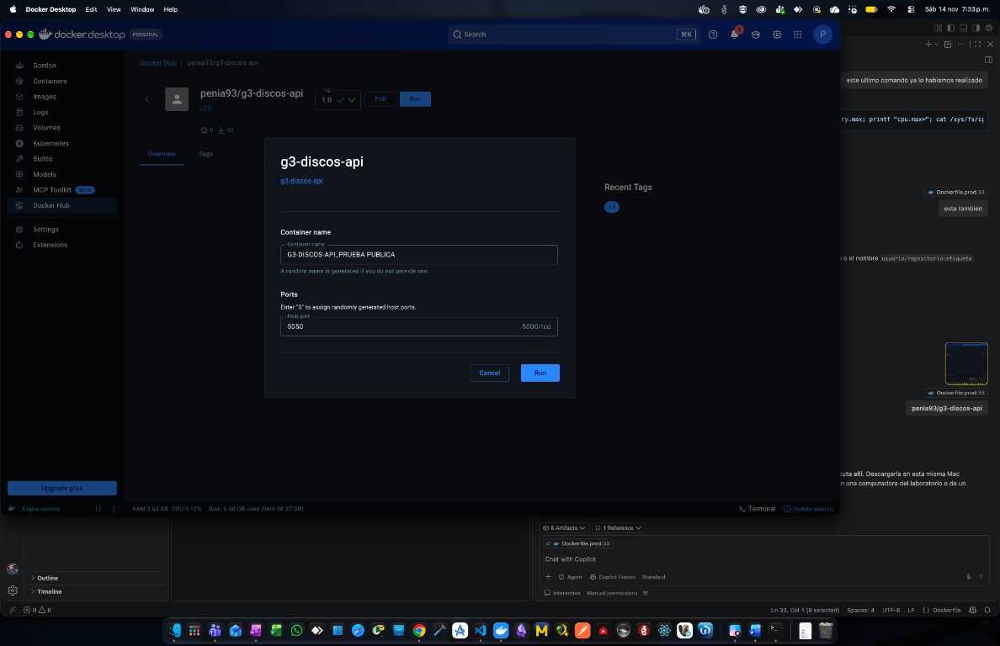

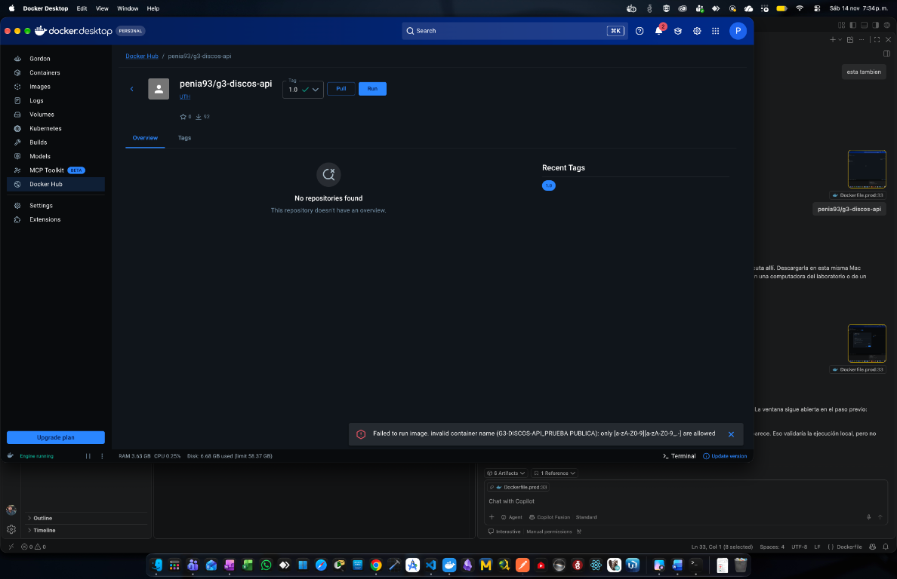

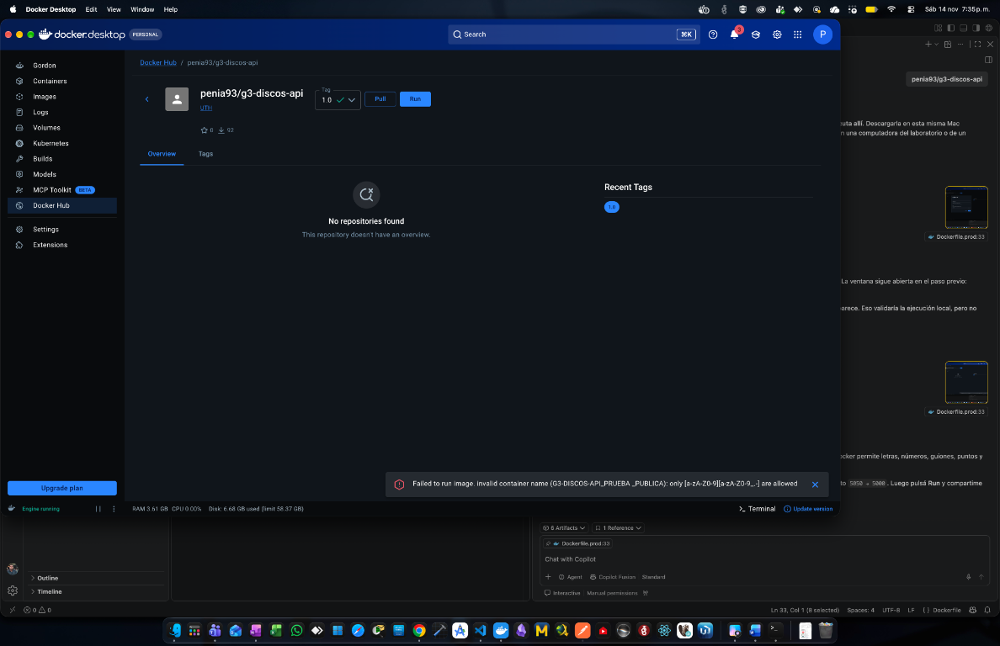

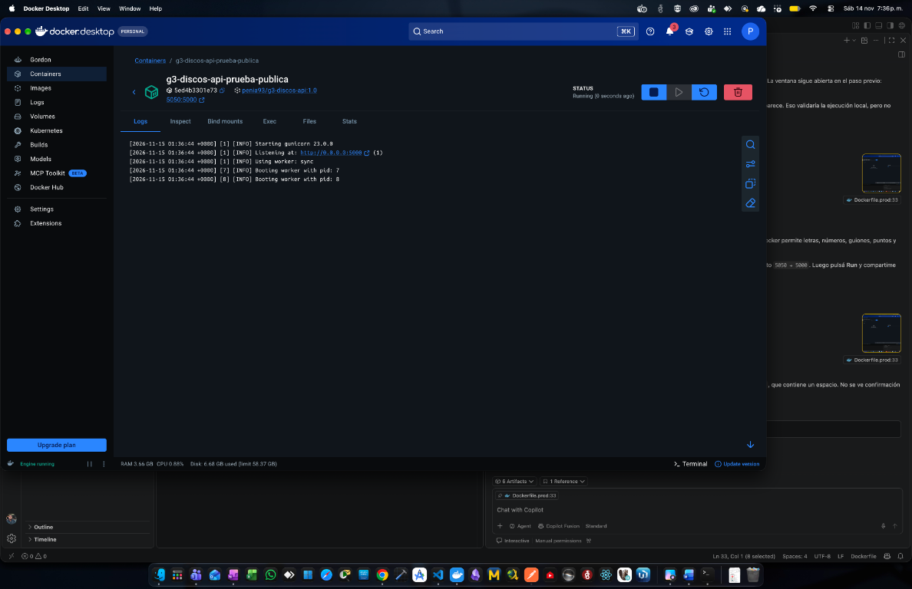

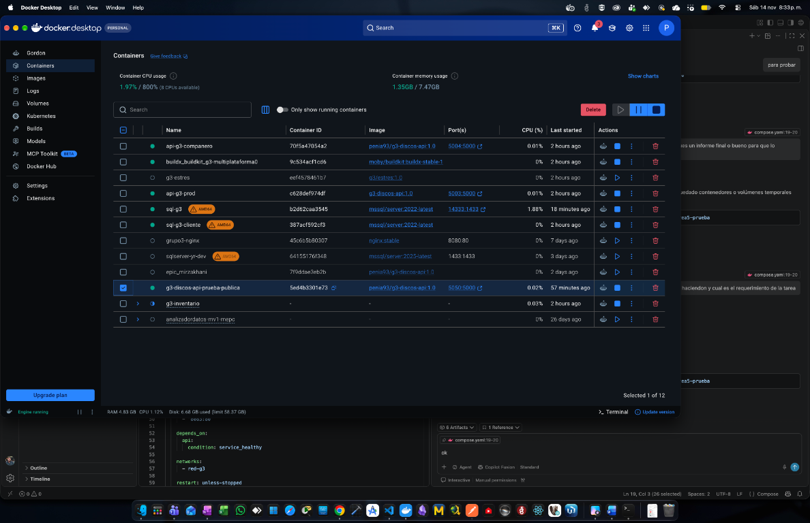

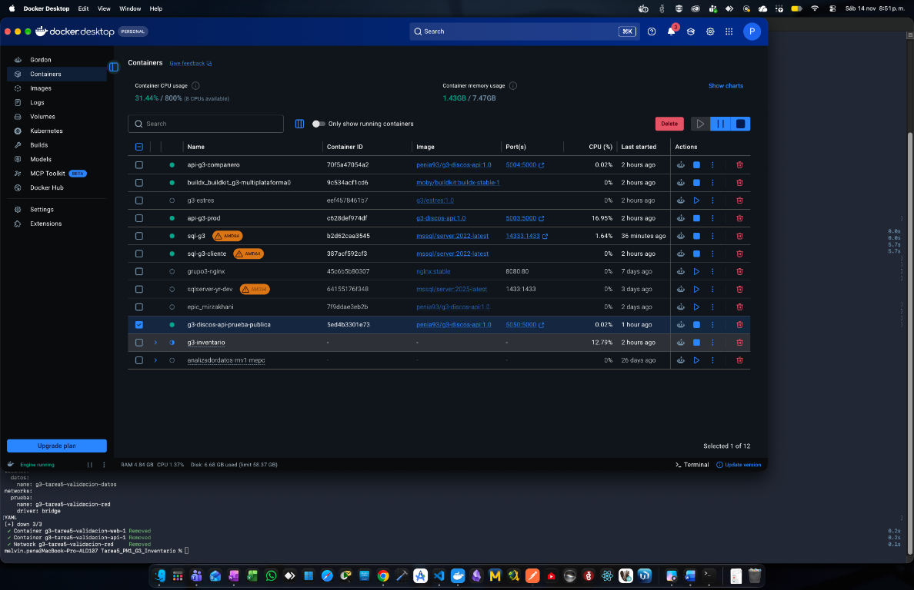

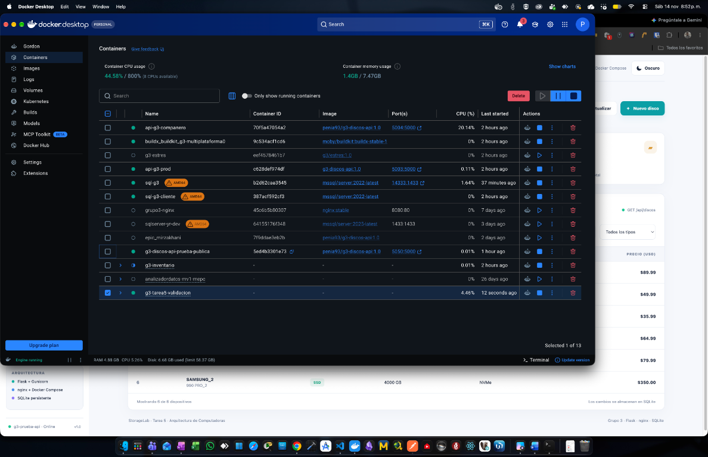

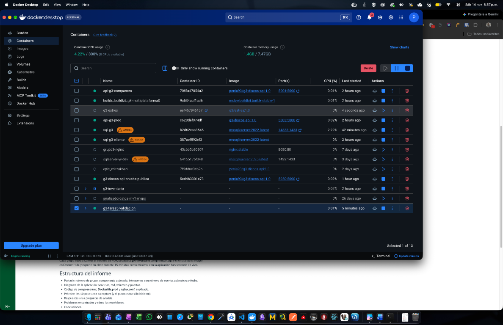

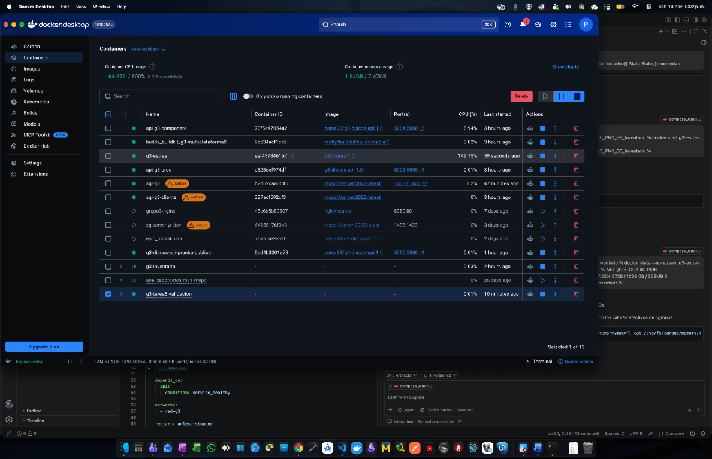

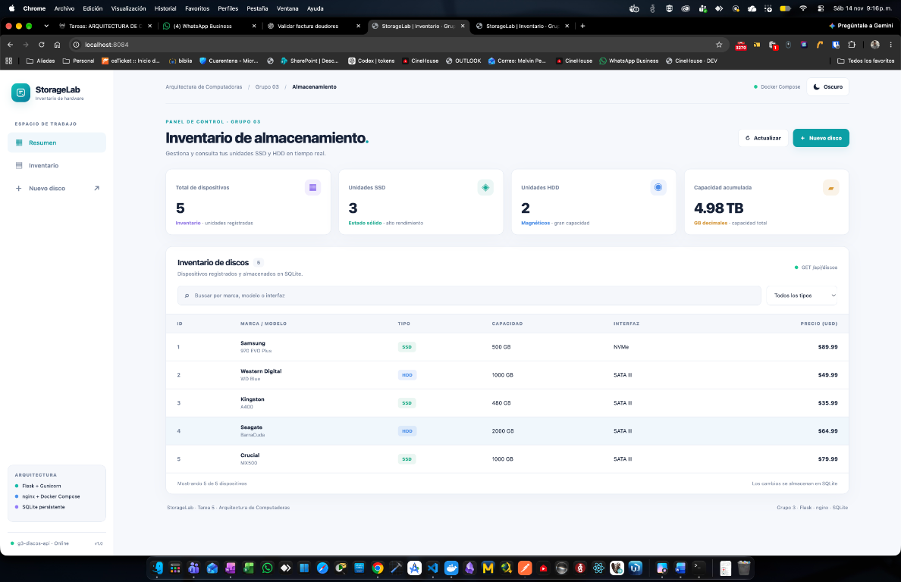

### Estado final observado del entorno aislado

Tras la comprobación de pérdida, el proyecto `g3-tarea5-validacion` se levantó de nuevo y quedó funcionando en `localhost:8084` con un volumen nuevo y cinco registros semilla. No se volvió a ejecutar `down -v`. El volumen `g3-inventario-datos` del proyecto principal se mantuvo intacto.
